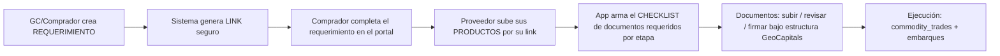

# Arquitectura de Operaciones — unificar los flujos en un solo sistema

> **Decisión tomada:** la **espina canónica es `operations`**. Los demás flujos se
> pliegan a ella. La generación de documentos arranca como **checklist de
> requeridos** (qué documento falta/está/se firmó por etapa), sin generar contenido
> todavía. La **unificación de UI/rutas** es de Lovable (`/src`); esta capa de datos
> (modelo, mapeo, RPC, checklist) es lo que la hace posible.

## 1. El problema: no hay "un sistema", hay cuatro flujos solapados

Revisando el repo, cuatro dominios hacen partes del mismo ciclo comprador↔vendedor,
cada uno con sus tablas —y algunos **duplican** invitaciones y documentos:

| Dominio             | Tablas núcleo                                                                                                                                                                                             | Qué hace                                                                                                                                  | Solapa con                                                                                                                               |
| ------------------- | --------------------------------------------------------------------------------------------------------------------------------------------------------------------------------------------------------- | ----------------------------------------------------------------------------------------------------------------------------------------- | ---------------------------------------------------------------------------------------------------------------------------------------- |
| **Operaciones**     | `operations`, `operation_participants`, `operation_invitations`, `operation_documents`, `operation_tasks`, `operation_messages`, `signature_envelopes`, `document_signatures`, `operation_status_history` | Deal room tripartito (comprador/vendedor/GC): link seguro, subida+revisión+**firma** de docs, tareas, chat por canal, historial de estado | — (el más completo)                                                                                                                      |
| **Trades**          | `commodity_trades`, `trade_documents`, `trade_events`, `trade_shipments`, `commodity_lots`, `commodity_inquiries`                                                                                         | Ejecución del negocio: etapas (`icpo`→…), **checklist de docs por fase** (`trade_documents.doc_type/phase`), embarques                    | `operations.linked_trade_id → commodity_trades`                                                                                          |
| **Suppliers / RFQ** | `suppliers`, `supplier_offers`, `offer_elements`, `supplier_documents`, `rfqs`, `rfq_products`, `rfq_applications`, `supplier_scores`, `risk_assessments`, **`invitation_links`**                         | Requerimientos de compra (RFQ) + registro de proveedores + ofertas + scoring/riesgo                                                       | **`invitation_links`** duplica `operation_invitations`; `rfq_products`/`supplier_offers` son "requerimiento" y "productos del proveedor" |
| **Offerings**       | `asset_offerings`, `offering_subscriptions`                                                                                                                                                               | Inversión tokenizada sobre proyectos                                                                                                      | (tangencial)                                                                                                                             |

**Duplicaciones a consolidar:**

- **Dos sistemas de invitación por link:** `operation_invitations.secure_token` vs
  `invitation_links`. → Unificar en `operation_invitations`.
- **Dos modelos de "documento con estado/fase":** `operation_documents` (subida+firma)
  vs `trade_documents` (`doc_type`/`phase`/`status`). → El checklist canónico se
  alinea a estos, no inventa un tercero.

## 2. El flujo objetivo (lo que pediste)

## 3. Modelo canónico: todo cuelga de `operations`

`operations` ya tiene el esqueleto (commodity, cantidad, incoterm, precio, estados
por parte, invitación con link, docs, firma). Se le enganchan las piezas que hoy
viven sueltas:

| Concepto del flujo                           | Hoy vive en                                               | En el modelo canónico                                                                       |
| -------------------------------------------- | --------------------------------------------------------- | ------------------------------------------------------------------------------------------- |
| **Requerimiento** (lo que pide el comprador) | `rfqs` + `rfq_products` / campos de `operations`          | `operations` (spec) **+** líneas de producto del requerimiento enlazadas por `operation_id` |
| **Link al comprador/proveedor**              | `operation_invitations` (✔) y `invitation_links` (dup)    | **`operation_invitations`** únicamente                                                      |
| **Productos del proveedor**                  | `supplier_offers` + `offer_elements` + `rfq_applications` | tabla/vista **de productos por operación** (`operation_id`, oferta del `seller`)            |
| **Documentos requeridos**                    | `operation_documents` + `trade_documents`                 | `operation_documents` (instancias) **+ checklist de estructura** (nuevo, esta capa)         |
| **Firma**                                    | `signature_envelopes` / `document_signatures` (✔)         | igual, sin cambios                                                                          |
| **Ejecución / embarques**                    | `commodity_trades` + `trade_shipments` (✔, ya enlazado)   | continúa vía `operations.linked_trade_id`                                                   |

## 4. La capa que construyo yo (backend) — sin tocar `/src`

**Territorio:** `supabase/migrations`, `packages/reglas`, `etl`, `tests`, `docs`.
La UI de "un solo sistema con un link" la unifica Lovable; yo entrego la espina de
datos y los RPC que consume.

### 4.1 Checklist de documentos requeridos (primer motor, alcance elegido)

- **Tabla `operation_document_structure`** (versionada, **editable**): por cada
  etapa (`operation_status`) y `rol` requerido (buyer/seller/geocapitals), qué
  `doc_kind` es obligatorio y en qué orden. Se siembra una estructura base derivada
  de los estados del deal (NDA→KYC→due diligence→term sheet→contrato→instrumento
  financiero→logística), **marcada `verificado_por='IA — por confirmar'` /
  `fecha_verificacion NULL`** hasta que GeoCapitals valide la lista real. **No se
  inventa como definitiva** una estructura legal.
- **RPC `operation_documents_checklist(operation_id)`** → cruza la estructura contra
  `operation_documents` y devuelve, por documento requerido, su estado:
  `falta | subido | en_revision | generado | firmado`. Eso es "la app dice qué
  documentos faltan bajo la estructura GeoCapitals".
- **Alineación:** el vocabulario `doc_kind` reusa `operation_documents.kind` y se
  mapea a `trade_documents.doc_type/phase` para no crear un tercer catálogo.

### 4.2 Productos del proveedor (siguiente)

- Modelo de **productos por operación** (specs/cantidad/precio/calidad/origen) que el
  proveedor sube por su link, reconciliando `supplier_offers`/`offer_elements`/
  `rfq_products` hacia `operation_id`.

### 4.3 Ciclo del requerimiento (siguiente)

- Transiciones explícitas (borrador→enviado→completado→bloqueado) como RPC con
  validación, sobre `operations` (+ `rfqs` plegado).

## 5. Preguntas abiertas / supuestos declarados (no invento)

1. **La lista real de documentos por etapa de GeoCapitals.** Es conocimiento de
   negocio. Plan: sembrar `operation_document_structure` **editable y marcada "por
   confirmar"**; tú la afinas (o me la pasas) y recién ahí queda verificada.
2. **Consolidar los dos sistemas de invitación** (`invitation_links` →
   `operation_invitations`): implica que Lovable migre las rutas de RFQ/proveedores.
   A coordinar.
3. **Quién es dueño de los documentos de ejecución**: `operation_documents` vs
   `trade_documents`. Propuesta: formación del deal en `operation_documents`;
   ejecución/embarque sigue en `trade_documents`, con el checklist leyendo ambos.

## 6. Secuencia propuesta

1. **Este documento** (mapa + modelo canónico). ✅
2. **Checklist de documentos** (`operation_document_structure` + RPC), estructura
   base editable marcada "por confirmar".
3. **Productos por operación** (reconciliar `supplier_offers`/`rfq_products`).
4. **Ciclo del requerimiento** (RPC de transiciones).
5. Consolidación de invitaciones (con Lovable).
