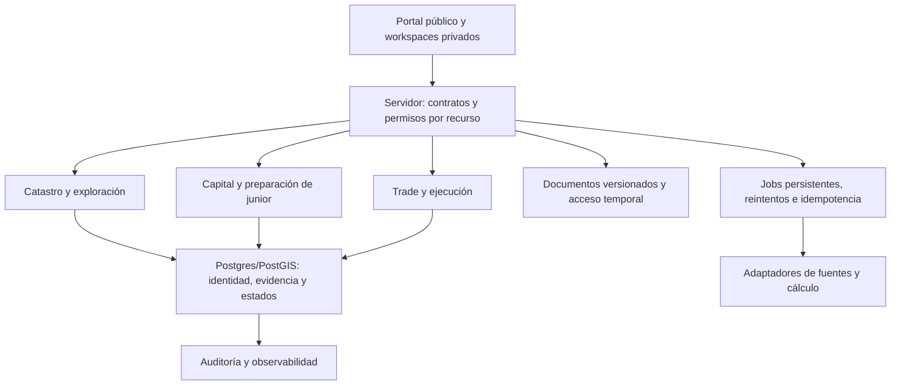

# Blueprint técnico global de Geocapitals

Estado: propuesta ejecutable basada en código; no certifica el estado de producción.
Base auditada: main, commit 0ffdcc92ae4b82ea61f7cc3eef394e45d71d473c.
Documento subordinado a GEOCAPITALS.md: especifica su arquitectura y secuencia de ejecución.
Decisiones de producto por confirmar se registran como supuestos, no como hechos.

## 1. Objetivo y límite inicial

Conectar activo minero, evidencia técnica, inversión por hitos y comercialización
con identidades estables, permisos por recurso y decisiones auditables.
Alcance internacional mediante adaptadores por jurisdicción, idioma, moneda y CRS.
Inicio propuesto: plataforma privada con oportunidades curadas. No se presupone
autorización para intermediación regulada, custodia de fondos o mercado público.
La preparación TSXV/TSX será un expediente de brechas con revisión profesional,
no una garantía de admisión ni un certificado generado por la plataforma.

## 2. Inventario comprobado y límites

En el árbol Git: 1.836 archivos y 179 archivos de rutas; estas cifras no representan
179 productos ni 179 endpoints públicos. Hay tests TypeScript y Python, pero
existir en Git no demuestra que estén ejecutándose ni que prueben la base viva.

| Dominio | Evidencia en Git | Reutilizar | Falta comprobar |
| --- | --- | --- | --- |
| Shell y módulos | src/lib/workspace.ts; _authenticated.tsx; useMyModules | WORKSPACE_NAV, selector de módulos, tabs, gates | Cobertura completa de rutas y autorización de endpoints |
| Proyectos | docs/project-workspace-v1.md; features/projects; routes projects | projectId, organizations, selector y adapters | Paridad de todos los proyectos y lectura pública |
| Catastro | lib/cadastre; migraciones global_cadastre_core; docs/catastro-unificado.md | cadastre_national y fuentes oficiales | Frescura, reconciliación, cobertura por país y migraciones aplicadas |
| Exploración | services/geoscience; engine3d; hooks y módulos técnicos | Datos de muestras, sondajes, geofísica y datasets | QA/QC operacional y lineage extremo a extremo |
| Visualización | GeoScene3D, registro de capas y legacyViewerRegistry | Visores canónicos y retiro condicionado a paridad | QA visual, rendimiento y snapshots reproducibles |
| Evidencia | geoscience_evidence_foundation y geo01_project_scope_invariants | Grafo y FKs compuestas por proyecto | Filas históricas y VALIDATE CONSTRAINT |
| Capital | deals, investments, listings, offerings; tests fundraise/underwriting | Componentes y cálculos comprobados | Flujo completo de suscripción, desembolso y conciliación |
| Trade | commodity_trades y operations; módulos sourcing/rfqs | Ejecución, portales, checklist, logística | Propiedad canónica de estados, aislamiento y concurrencia |
| Documentos | operation_documents, trade_documents; lib/pdf; firmas | Marca PDF institucional y versiones | Acceso, expiración, inmutabilidad y validez del método de firma |
| Calidad | package.json y .github/workflows/ci.yml | typecheck, lint, Vitest y build | CI verde y pruebas de integración/RLS |

El documento maestro menciona 135 tablas y 35 Edge Functions: tratarlo como una
afirmación documental histórica hasta inventariar el esquema y despliegue actuales.
La CI consultada para esta base pasó typecheck y falló lint con 95 errores y 18
advertencias; tests y build fueron omitidos. No afirmar plataforma operativa por ello.

## 3. Fragmentación concreta

1. Documentación de navegación atrasada: se describe un menú de 48 ítems, pero
   workspace.ts ya agrupa navegación por módulos y tabs. No reconstruir ese trabajo.
2. Contradicción de espinas: arquitectura-operaciones.md elige operations, mientras
   estado-y-simplificacion.md llama spine a Trades. Ambos existen en código.
3. Invitaciones, documentos y estados repartidos entre operaciones, trades,
   proveedores y RFQ. Una pestaña compartida no elimina duplicación de escrituras.
4. Dashboards específicos siguen coexistiendo con adapters y visores canónicos.
   legacyViewerRegistry ya diferencia compatibilidad pública, referencia y QA.
5. Rutas con demasiadas responsabilidades: dashboard.trades.tsx ocupa 81.624
   bytes; TrackminDashboard.tsx 56.771; LosVerdesEngine3D.tsx 91.481. Tamaño
   por sí solo no es un defecto; priorizar permisos, estado y lógica mezclados.
6. Acceso fragmentado: permisos UI, entitlements, middleware servidor y RLS
   no son equivalentes. roleMiddleware concedía unrestricted ante respuesta nula.
7. Vocabulario de evidencia múltiple: estados verified/derived/conceptual/pending
   y clases OFFICIAL/CERTIFIED/DECLARED/etc. necesitan dimensiones diferenciadas.
8. Roadmaps paralelos indican avances históricos como pendientes. Consolidar estado
   en este backlog y GEOCAPITALS.md, conservando documentación especializada.

## 4. Arquitectura objetivo: monolito modular

Mantener TanStack Start, React, Supabase/Postgres/PostGIS, Storage y Edge Functions.
No introducir microservicios sin una necesidad de escala medible.

Cada dominio concentra contratos, servicios, reglas de estado y pruebas.
Las rutas son wrappers; las features presentan datos y no mantienen otra
identidad de proyecto. Extraer por cambios pequeños, sin mover todo src de una vez.
Migrar lecturas a servicios/React Query con keys que incluyan organización,
proyecto, filtros y visibilidad cuando corresponda.

## 5. Propiedad de datos y contratos

| Entidad | Propietario propuesto | Regla |
| --- | --- | --- |
| Organización y usuario | Núcleo existente | Tenant y pertenencia explícitos |
| Proyecto y concesión | Projects / Catastro | Concesión global oficial enlazada al proyecto; sin copias por dashboard |
| Dataset, muestra, ensayo, target, modelo | Exploración | projectId, CRS, unidades, fuente, revisión y hash/version cuando aplique |
| Interpretación y escenario económico | Exploración / Economía | Separados de mediciones; supuestos y fecha reproducibles |
| Emisor junior / vehículo | Capital | Enlaza organización y proyectos; no confundir proyecto con emisor |
| Oferta, instrumento, compromiso y desembolso | Capital | Estados y libro de eventos propios; conciliar dinero con evidencia externa |
| Operación colaborativa | Operations | Participantes, invitaciones, tareas y expediente de negociación |
| Trade ejecutable | Commodities | Precios, margen, contratos comerciales, embarques y liquidación |
| Lote y pasaporte mineral | Commodities | Trazabilidad de material producido; nunca convertir un target en lote |
| Documento y firma | Documentos | Versión inmutable y referencia al dominio; permisos heredados del recurso |

Decisión propuesta para resolver el solapamiento: operations es el deal room;
commodity_trades es el agregado de ejecución comercial. Mantener
operations.linked_trade_id como puente. Auditar cardinalidad real antes de
imponer UNIQUE o migrar datos. Cada campo y transición tendrá un solo propietario.
No implementar sincronización bidireccional de estados sin reglas de conflicto.
RFQ y sourcing convergen mediante adapters; no borrar modelos antes de migrar
consumidores, conciliar registros y preservar enlaces históricos.

Contrato mínimo de evidencia:
entityRef, projectId, sourceRef, sourceDate, ingestedAt, datasetVersion, evidenceClass,
validationStatus, reviewerRef, crs y units según el dato.
evidenceClass expresa origen; validationStatus expresa revisión. Una clase oficial
no convierte automáticamente una interpretación en recurso certificado.
Conservar vocabularios existentes mediante mappings versionados, sin reclasificar
historia silenciosamente.

## 6. Experiencia de producto

Tres espacios sobre el mismo expediente:
- Exploración: resumen, tenencia, campañas, evidencia, targets, modelos y validación.
- Capital: oportunidad, data room, due diligence, financiamiento, hitos y seguimiento.
- Trade: requerimiento, contrapartes, producto, contrato, logística y conciliación.

Administración transversal: usuarios, permisos, planes, auditoría y configuración.
Vista inversionista de solo lectura con proyección explícita de campos:
riesgos, evidencia, capital requerido y uso de fondos. Nunca reutilizar el DTO
interno de margen, comisiones o datos personales como DTO público.

## 7. Capital y camino a junior TSXV/TSX

Reutilizar deals/listings/investments; verificar sus contratos antes de ampliar.
El expediente de emisor debe cubrir estructura societaria, cap table y dilución,
opciones/warrants, titularidad de activos, estados financieros, administración,
conflictos y documentación técnica con responsables.
Financiamiento por hitos: presupuesto aprobado -> compromiso -> cierre ->
desembolso documentado -> ejecución -> evidencia del hito -> revisión.
Mostrar moneda, fecha de valoración, fuentes y escenarios de dilución; no confundir
compromiso con efectivo recibido.

Matriz de preparación versionada por mercado, jurisdicción y ruta de admisión:
requisito, evidencia, responsable, revisión, brecha, plazo y decisión.
No codificar umbrales de bolsa sin fuentes vigentes y revisión de asesores.
NI 43-101 requiere tratamiento específico por Qualified Persons y revisión de
divulgación. Readiness interno no equivale a cumplimiento ni admisión.
JORC/S-K 1300 se incorporan mediante adapters separados cuando haya demanda real.

## 8. Trade y pasaporte de producto

Origen/derecho de venta -> KYC/KYB -> especificación y ensayes -> fórmula de precio ->
contrato -> inspección -> embarque -> entrega -> liquidación.
Fórmula de margen versionada: precio, unidades, FX, calidad, humedad, pagabilidad,
TC/RC, penalidades, flete, seguro y financiamiento con fecha y fuente.
Distinguir indicativo, cotizado, contratado y liquidado.
Ledger de custodia y transformación para splits/blends y balance de masa con
mediciones, hashes y referencias externas. Reutilizar Mining Asset Graph.
Un pasaporte interno no implica certificación externa ni cumplimiento de DPP.

## 9. Urgencias y secuencia de PR

| ID | Prioridad | Cambio concreto | Dependencia | Criterio de salida |
| --- | --- | --- | --- | --- |
| SEC-01 | P0 | Denegar entitlements ausentes, fallidos o malformados en servidor | RPC get_my_modules | Casos negativos y grants explícitos; CI |
| SEC-02 | P0 | Autorizar create/void de firmas y mutaciones de invitaciones/tareas por recurso y acción | Matriz RLS/roles | Tenant A no lee ni modifica B; lector no firma/gestiona por privilegio de módulo |
| SEC-03 | P0 | Autorizar creación de sobres de proyecto; validar estados y expiración | Permisos de proyecto | JWT válido sin permiso recibe 403, sin escritura |
| SEC-04 | P0 | OTP atómico, límite de emisión/verificación y revocación | Esquema portal real | Concurrencia: un consumo válido; límite sin incrementos perdidos |
| SIG-01 | P0 | Firma transaccional y contador consistente; revisar HMAC | Triggers de firmas | Dos firmantes simultáneos completan exactamente una vez |
| CI-01 | P0 | Corregir lint y ejecutar todas las validaciones | Base de herramientas | typecheck/lint/test/build verdes sin desactivar reglas para ocultar errores |
| DB-01 | P0 | Inventario y drift de esquema, RLS, Storage, funciones y migraciones | Acceso a staging/base | Informe de diferencias, backup/restauración comprobada, plan de aplicación |
| CORE-01 | P1 | ADR de Operations/Trades, catálogo de campos y transiciones | DB-01 | Un escritor por campo; puente reconciliado sin duplicados |
| GEO-01 | P1 | Auditar y validar FKs históricas por proyecto | DB-01 | Cero referencias cruzadas; constraints validadas |
| DOC-01 | P1 | Versiones, expiración, proyección pública y firma común | SEC/SIG | Revocación bloquea acceso; publicación usa versión revisada |
| UX-01 | P1 | Dos proyectos con workspace/adapter canónico y rutas compatibles | GEO/DOC | Alta de proyecto sin otro dashboard; no contaminación de geometrías |
| CAP-01 | P1 | Data room y financiamiento por hitos | CORE/DOC | Compromisos, desembolsos y evidencia diferenciados |
| TRD-01 | P1 | Piloto trade reconciliado | CORE/DOC | Calidad/precio/documentos/embarque/pago trazables |
| JUN-01 | P2 | Expediente de emisor y matriz TSXV/TSX | CAP-01 y asesores | Brechas revisadas con fuentes, responsable y fecha |
| OBS-01 | P1 | Request IDs, eventos y jobs con métricas | Contratos API | Diagnóstico por operación sin registrar tokens/secretos |
| GEO-02 | P2 | Retirar viewers legacy con paridad | CI/QA/snapshots | Gate de retirement cumplido; enlaces conservados |

Los P0 deben cerrarse antes de habilitar pilotos con datos sensibles o cierres reales.
No desplegar migraciones ni borrar tablas como parte de este documento.

## 10. Primer incremento de implementación

SEC-01: parser puro de entitlements y uso en roleMiddleware.
El valor unrestricted se acepta solamente cuando el RPC entrega un contrato válido.
Una falla no habilita los tres módulos. Se conserva el tratamiento existente de
staff/superadmin; su origen y capacidad de modificar account_type deben auditarse
en SEC-02. Este cambio no resuelve por sí solo autorización por recurso.
Añadir tests de ausencia, errores, payload malformado, denial y grants válidos.

Siguiente incremento: SEC-02/03 con tests de dos organizaciones, revisión de
políticas de lectura y escritura y comprobación de triggers. Evitar sustituir
autorización de escritura por una mera consulta SELECT que un lector pueda pasar.

## 11. Validación y liberación

- Unitarias: permisos, fórmulas económicas, estados, evidencia y contratos.
- Integración Postgres: RLS con JWT de A/B, constraints y transacciones concurrentes.
- E2E: invitación -> acceso -> documento -> firma; proyecto -> evidencia -> ficha;
  trade -> embarque -> liquidación.
- QA visual: proyectos distintos, público/privado, mapas, cámara y snapshots.
- Operación: migraciones probadas en staging, jobs idempotentes, rollback por
  incremento, restauración de backup y logs sin secretos.
- Merge exige comprobaciones verdes. Cambios de permisos fallan cerrados ante
  error; exponer mensaje recuperable al usuario, no conceder acceso.

## 12. Ejecución por gates

G0: P0 de seguridad y calidad; esquema vivo conocido.
G1: contratos canónicos y dos proyectos piloto (selección por confirmar).
G2: una oportunidad con data room y presupuesto por hitos.
G3: un trade piloto reconciliado y expediente de junior con brechas revisadas.
Los plazos se estiman después de DB-01 y conocer equipo/capacidad; no prometer
un calendario fijo basado solamente en número de pantallas.

Métricas iniciales: violaciones de aislamiento, fallos de acceso, jobs fallidos,
documentos sin fuente, constraints sin validar y flujos piloto completos.
Medir línea base antes de fijar objetivos de rendimiento o conversión.
