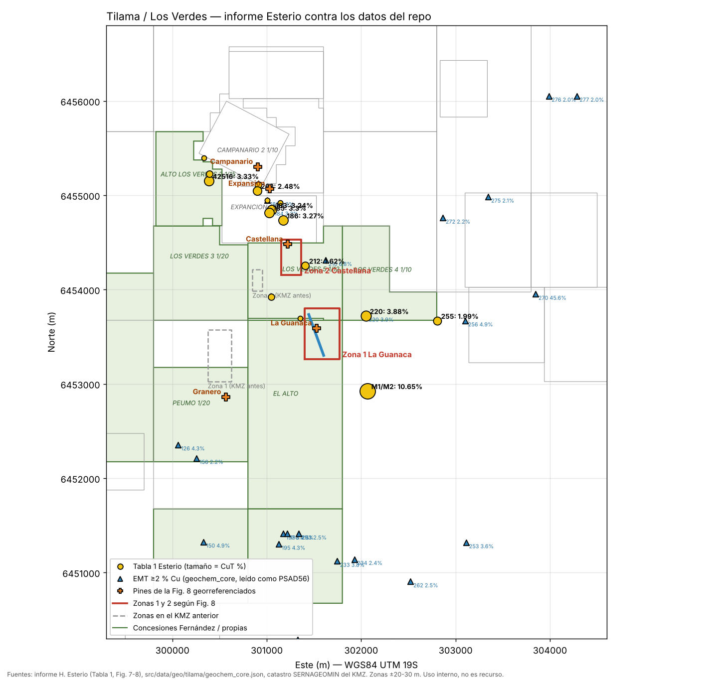

# Tilama / Los Verdes — revisión del informe Esterio contra los datos del repo

Fecha de la revisión: 13-11-2026. Uso interno. Nada de esto es recurso ni reserva.

## Fuente

Informe "Actualización de la información geológica de las propiedades mineras Alto Los Verdes…, sector de Tilama", de Harry Esterio G., preparado para Carlos Fernández Vásquez y Carlos Fernández Chacana. El pie de página dice 24-08-2014, pero la visita a terreno fue en julio de 2016 y las imágenes de las figuras 7 y 8 son de 2016, por lo que el informe es de 2016. La copia escaneada repite la página 14 (Tabla 1).

## Coordenadas de la Tabla 1

Las 17 muestras traen coordenadas en PSAD56 y en WGS84 (huso 19S). La conversión entre ambas columnas cuadra al metro. La Figura 8 está dibujada en WGS84: al georreferenciarla con 12 de esas muestras el ajuste queda bajo 10 m, lo que permite ubicar con confianza los pines y las zonas de interés.

## Zonas de interés (Fig. 8 georreferenciada)

| Zona | WGS84 19S (E / N) | Superficie | Concesión |
|---|---|---|---|
| 1 · La Guanaca | 301.403–301.768 / 6.453.264–6.453.801 | 19,6 ha | 77 % EL ALTO (Fernández Chacana, exploración), 21 % LOS VERDES 5 |
| 2 · La Castellana | 301.155–301.365 / 6.454.153–6.454.530 | 7,9 ha | 91 % LOS VERDES 5, 9 % EXPANCION 1/12 (Minera AGV) |

El KMZ anterior tenía la Zona 1 a ~1,1 km al WSW y la Zona 2 a ~400 m al WSW de estas posiciones. La veta de La Guanaca dibujada en la figura mide ~460 m, no los 600 m del cálculo.

## Muestras de mayor ley y dónde caen

Las mejores leyes de cobre de la Tabla 1 en concesiones de Fernández Vásquez son TOO-220 (3,88 % CuT, Ag 88 ppm, Zn 2.437 ppm; LOS VERDES 4), 42516 (3,33 % CuT, Au 4,9 ppm; ALTO LOS VERDES 2) y TOO-212 (1,62 %; LOS VERDES 5). TOO-183, 185, 186 y 262 (2,5–3,3 % CuT) están dentro de EXPANCION 1/12, de Minera AGV Gold Copper, es decir, en terreno de un tercero. M1 y M2 (7,7 % y 10,65 % CuT, desmontes) comparten una misma coordenada y quedan 267 m fuera de EL ALTO, sin concesión en el catastro cargado; hay que revisar en SERNAGEOMIN si ese terreno está libre. TOO-255 (1,99 %) queda en el borde de LOS VERDES 4.

## Datos del repo

`src/data/geo/tilama/geochem_core.json` (transcripción del Anexo B de EMT, 190 muestras) está en PSAD56, no en WGS84 como dice `src/lib/tilama/geochem.ts`: TOO-220 y TOO-255 coinciden exactamente con la columna PSAD56 de Esterio. Todo lo que se dibuja desde ese archivo queda corrido ~416 m al NNE. Además, la transcripción tiene filas y columnas desplazadas: TOO-183 y TOO-184 tienen las coordenadas intercambiadas, TOO-184 trae 3,2 % Cu cuando Esterio da 0,03 %, el campo Mo de TOO-220 y TOO-255 tiene los valores de Pb, Ag y Au aparecen en el límite de detección en muestras donde Esterio reporta 53–88 ppm Ag, 45 muestras comparten coordenada con otra, y TOO-270 (45,6 % Cu) no es creíble como ensaye. El archivo no sirve para ubicar trabajos ni para estadística hasta cotejarlo con el original de EMT.

La migración `20261113040000` cargó las 17 muestras de Esterio sin coordenadas, aunque la tabla sí las trae, con código `T00-` en vez de `TOO-` (no cruza con EMT), y con Pb de TOO-255 en 338 ppm; en el escaneo se lee 358, aunque es dudoso.

## Otras inconsistencias del informe

El potencial a la vista (3,75 Mt @ 2 % Cu) no es reproducible: con las leyes del propio texto el ponderado da ~3,4 % Cu, la Zona 2 trae dos leyes distintas (3,5–4 % y 0,8–1 %), y el ancho de 10 m no se respalda con lo descrito (vetas de 2–10 m; cuerpo de Expansión de 1 m). La Guanaca aparece como Alto Los Verdes 3 y como Alto Los Verdes 4. El informe solo describe el acceso regional (Ruta 5 → La Ligua → E-35 → Pedegua → D-37-E → Tilama), aunque la Figura 1 dibuja la ruta E-37 por Cabildo; no hay caminos internos. En la Figura 7 hay una línea manuscrita de "inicio" a "fin" entre Castellana y La Guanaca que el texto no explica.

